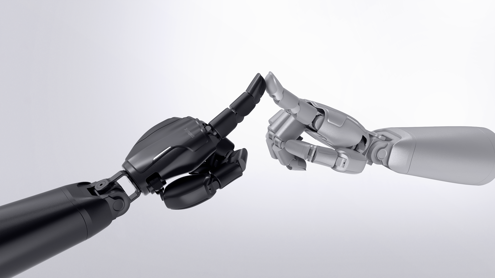

  

  

  

## Products

<table>
  <tr>
    <td width="50%" align="center" valign="middle">
      
    </td>
    <td width="50%" align="center" valign="middle">
      <h3><a href="https://github.com/xynova-tech/Flex2"><ins>Flex 2</ins></a></h3>
      
Bionic Versatility, Intelligent Stability.

      
Hybrid-drive dexterous hand

      
<a href="https://github.com/xynova-tech/Flex2"><ins>Repository</ins></a> · <a href="https://github.com/xynova-tech/Flex2/releases"><ins>Downloads</ins></a> · <a href="https://docs.xynova.com.cn/docs/flex2/"><ins>Docs</ins></a>

    </td>
  </tr>
  <tr>
    <td width="50%" align="center" valign="middle">
      
    </td>
    <td width="50%" align="center" valign="middle">
      <h3><a href="https://github.com/xynova-tech/Prima1"><ins>Prima 1</ins></a></h3>
      
Direct-Drive Transparency, Perceptive Infinity.

      
Direct-Drive Dexterous Hand

      
<a href="https://github.com/xynova-tech/Prima1"><ins>Repository</ins></a> · <a href="https://github.com/xynova-tech/Prima1/releases"><ins>Downloads</ins></a> · <a href="https://docs.xynova.com.cn/docs/prima1/"><ins>Docs</ins></a>

    </td>
  </tr>
  <tr>
    <td width="50%" align="center" valign="middle">
      
    </td>
    <td width="50%" align="center" valign="middle">
      <h3><a href="https://github.com/xynova-tech/Synca-XFS"><ins>Synca XFS</ins></a></h3>
      
Native Arm-Hand, Boundless Dexterity.

      
Integrated Arm-Hand System

      
<a href="https://github.com/xynova-tech/Synca-XFS"><ins>Repository</ins></a> · <a href="https://github.com/xynova-tech/Synca-XFS/releases"><ins>Downloads</ins></a> · <a href="https://docs.xynova.com.cn/docs/rotary-actuator/"><ins>Docs</ins></a>

    </td>
  </tr>
</table>

## Getting Started

1. **Pick your product** — open its repository above
2. **Read the docs** — <a href="https://docs.xynova.com.cn/"><ins>Documentation Center</ins></a> or repo README
3. **Download software** — SDK · Studio · Simulation under Releases

## Contact

   &nbsp; <strong>Website</strong> — <a href="https://www.xynova.com.cn/"><ins>www.xynova.com.cn</ins></a> 
   &nbsp; <strong>Documentation</strong> — <a href="https://docs.xynova.com.cn/"><ins>docs.xynova.com.cn</ins></a> 
   &nbsp; <strong>Technical support</strong> — <a href="mailto:contact-us@xynova.tech"><ins>contact-us@xynova.tech</ins></a>

© Xynova — Building the future of dexterous manipulation.
